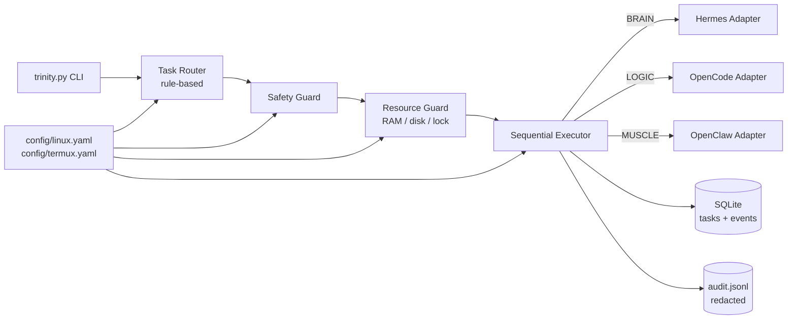

# TRINITY v3.1

**Lightweight AI Agent Orchestrator** — điều phối ba agent độc lập theo kiến trúc Adapter. v3.1 bổ sung resume theo Task ID, lock fail-closed và chính sách OpenCode agent tường minh.

| Vai trò | Agent | Nhiệm vụ |
|---|---|---|
| **BRAIN** | Hermes | Memory, context, skills |
| **LOGIC** | OpenCode | Đọc/phân tích code, implementation, testing |
| **MUSCLE** | OpenClaw | Tự động hóa hệ thống, CLI, gateway |

Trinity **không** sao chép hoặc thay thế mã nguồn lõi của ba công cụ. Nó chỉ lập kế hoạch, kiểm tra an toàn, gọi adapter theo thứ tự và lưu lịch sử.

Repository: <https://github.com/vukiengiang2025-sys/trinity-v3>

> **Trạng thái thực tế tại môi trường build (2026-11-04, v3.1)**
> - Linux Mint 22.3, Python 3.12.3, OpenCode v2.2.5: **đã xác minh CLI**.
> - Hermes: **UNAVAILABLE** (không có executable).
> - OpenClaw: **UNAVAILABLE** (không có executable/gateway).
> - OpenCode execution **fail closed**: phải cấu hình `adapters.opencode.agent` đã kiểm tra permission; không tự dùng agent mặc định.
> - **Đã chạy read-only prompt thật** qua OpenCode với agent tạm `trinity-readonly` trong workspace giả: task `TRN-20261104-152925-1c79c9` COMPLETED, workspace/Git không đổi, `/etc/passwd` bị `external_directory` deny.
> - Chưa xác minh agent production (`build`/`general`); mặc định vẫn fail closed nếu chưa cấu hình `agent`.
> - HTTP API của OpenCode chỉ được health-check; endpoint thực thi có auth **chưa xác minh**, nên mặc định tắt.
> - CI GitHub Actions: **v3.1 (143 test) PASS** trên Python 3.9 và 3.12.
> - **143 unittest — 0 failure**.
>
> Trinity không tuyên bố tích hợp đầy đủ ba agent khi adapter tương ứng chưa được xác minh.

---

## 1. Kiến trúc



```text
CLI
 └─ Router (phân loại, risk, execution_plan)
     └─ Safety Guard (workspace, path, command, git, secrets)
         └─ Resource Guard (RAM, disk, timeout, single-task lock)
             └─ Executor (tuần tự, không chạy song song)
                 ├─ HermesAdapter   (BRAIN)
                 ├─ OpenCodeAdapter (LOGIC)
                 └─ OpenClawAdapter (MUSCLE)
                     ├─ SQLite TaskManager
                     └─ AuditLog JSONL
```

Nguyên tắc:

- **On-demand**: không chạy agent nền, không tự khởi động server/gateway.
- **Sequential**: mỗi lúc chỉ một tác vụ; khóa `fcntl` trong `logs/.trinity.lock`.
- **Adapter pattern**: thêm agent mới = thêm adapter, không sửa executor.
- **Fail closed**: thiếu guard/allowlist/timeout thì từ chối, không đoán.
- **Không secrets trong SQLite/audit**: prompt, kết quả, lỗi, event đều được redact.

---

## 2. Yêu cầu hệ thống

| Thành phần | Linux Mint | Termux |
|---|---|---|
| Python | 3.9+ | 3.9+ |
| RAM trống tối thiểu | 384 MB | 192 MB |
| Ổ đĩa trống tối thiểu | 200 MB | 150 MB |
| Dependency Python | `PyYAML>=6.0,<7.0` | `PyYAML>=6.0,<7.0` |
| Git | khuyến nghị | khuyến nghị |

Không cần framework web, Docker, database server. SQLite và toàn bộ phần còn lại dùng Python Standard Library.

---

## 3. Cài đặt trên Linux Mint

```bash
git clone https://github.com/vukiengiang2025-sys/trinity-v3.git
cd trinity-v3

# Khuyến nghị: virtualenv riêng, không đụng môi trường hệ thống
python3 -m venv .venv
source .venv/bin/activate

python3 -m pip install -r requirements.txt
python3 trinity.py doctor
python3 trinity.py status
```

Nếu không dùng virtualenv:

```bash
python3 -m pip install --user -r requirements.txt
```

Không cần cài Hermes/OpenClaw/OpenCode bằng Trinity. Trinity chỉ phát hiện và sử dụng các công cụ đã có.

---

## 4. Cài đặt trên Android Termux

```bash
pkg update
pkg install python git

git clone https://github.com/vukiengiang2025-sys/trinity-v3.git
cd trinity-v3

python3 -m pip install -r requirements.txt

export TRINITY_PROFILE=termux
python3 trinity.py doctor
python3 trinity.py status
```

Nếu làm việc với thư mục dùng chung:

```bash
termux-setup-storage
# sau đó đặt workspace.root trong config/termux.yaml hoặc truyền --profile
```

Lưu ý: Termux có thể yêu cầu quyền truy cập bộ nhớ; Trinity không tự cấp quyền hệ thống.

---

## 5. Profile cấu hình

```text
config/linux.yaml   # Linux Mint / Debian / Ubuntu
config/termux.yaml  # Android Termux
```

Tự phát hiện:

- Termux nếu biến `PREFIX` chứa `com.termux` hoặc tồn tại `/data/data/com.termux/files/usr`.
- Ngược lại dùng `linux`.

Chọn thủ công:

```bash
python3 trinity.py --profile termux status
python3 trinity.py config --profile termux
```

Hoặc:

```bash
export TRINITY_PROFILE=termux
```

Các khóa quan trọng:

```yaml
workspace:
  root: "."
  allowed_roots: ["."]

storage:
  db_path: "~/.trinity/trinity.db"
  log_dir: "logs"

resources:
  min_free_ram_mb: 384       # Termux: 192
  min_free_disk_mb: 200      # Termux: 150
  default_timeout_seconds: 900
  max_timeout_seconds: 3600
  max_concurrent_tasks: 1
  on_low_memory: deny        # deny | warn

guard:
  require_approval_for_risk: ["high"]
  allowed_commands: [...]    # allowlist executable

adapters:
  opencode: { ... }
  hermes: { ... }
  openclaw: { ... }
```

**Không đặt API key, token, mật khẩu hoặc credential vào YAML.** Trinity không đọc file `.env`, không đọc provider config và không cần secrets để chạy kiểm tra cục bộ.

`--db` cho phép ghi đè SQLite (hữu ích khi test):

```bash
python3 trinity.py --db /tmp/trinity-test.db tasks
```

---

## 6. CLI

```bash
python3 trinity.py status
python3 trinity.py doctor
python3 trinity.py run "Nội dung nhiệm vụ"
python3 trinity.py resume <task_id> --approve
python3 trinity.py tasks
python3 trinity.py task <task_id>
python3 trinity.py config
python3 trinity.py version
```

### `status`

Hiển thị profile, workspace, SQLite, RAM/ổ đĩa, trạng thái ba adapter. Không tạo DB, không chạy agent.

### `doctor`

Chẩn đoán môi trường: Python, OS, workspace, quyền ghi DB/log, RAM, disk, Git, SQLite, adapter, self-test Guard, secrets trong config. Trả mã `1` nếu có mục `FAIL`.

### `run`

```bash
# Chỉ lập kế hoạch, KHÔNG ghi SQLite/audit, KHÔNG gọi adapter
python3 trinity.py run --dry-run "sửa lỗi pytest trong core/router.py"

# Chạy thật (có thể gọi OpenCode nếu AVAILABLE)
python3 trinity.py run "sửa lỗi pytest trong core/router.py"

# Tác vụ rủi ro cao cần phê duyệt rõ ràng
python3 trinity.py run "xóa dữ liệu production"
# -> WAITING_APPROVAL, exit code 3, in ra Task ID

# Tiếp tục đúng task cũ (không tạo task trùng)
python3 trinity.py resume <task_id> --dry-run
python3 trinity.py resume <task_id> --approve

# Giới hạn thời gian mỗi adapter
python3 trinity.py run --timeout 120 "phân tích module python"
```

`run --approve` vẫn tồn tại cho tác vụ mới, nhưng luồng khuyến nghị là `resume` để giữ nguyên Task ID, plan, và ghi nhận phạm vi phê duyệt.

Exit code:

| Mã | Ý nghĩa |
|---|---|
| `0` | Thành công hoặc dry-run |
| `1` | Tác vụ thất bại / lỗi runtime |
| `2` | Lỗi cú pháp, profile, config, task không tồn tại |
| `3` | `WAITING_APPROVAL` — dùng `resume <task_id> --approve` |

`run` không tự chạy song song. Nếu đang có tác vụ khác giữ lock, task mới chuyển `FAILED` với lý do rõ ràng.

### `resume`

```bash
python3 trinity.py resume <task_id>              # chỉ kiểm tra, không chạy
python3 trinity.py resume <task_id> --dry-run    # kiểm tra Guard/Resource/plan
python3 trinity.py resume <task_id> --approve    # claim task và chạy tiếp
```

- Chỉ task `WAITING_APPROVAL` mới resume được.
- Giữ nguyên Task ID, plan, prompt đã lưu (đã redact) và risk.
- Kiểm tra lại profile, workspace, Guard, Resource, adapter availability.
- `claim_for_resume` là UPDATE có điều kiện `WHERE status='WAITING_APPROVAL'`, đảm bảo chỉ một tiến trình chạy.
- Lưu `approved_by`, `approved_at`, `approval_scope` (hash plan), `resume_count`.
- Không resume task v3.0 thiếu `plan_json`/`workspace`; báo lỗi thay vì đoán.
- Nếu adapter/resource/lock chưa sẵn sàng, task **vẫn WAITING_APPROVAL** để có thể thử lại an toàn.

### `tasks`, `task`

```bash
python3 trinity.py tasks
python3 trinity.py tasks --limit 50 --status FAILED
python3 trinity.py task TRN-20261104-143120-bce909
```

### `config`, `version`

```bash
python3 trinity.py config
python3 trinity.py version
```

`config` in cấu hình hiệu lực đã che secrets. `version` không cần DB/Internet.

---

## 7. Tích hợp Adapter

### 7.1 OpenCode — LOGIC (đã xác minh CLI)

- Phát hiện: `which opencode`, `opencode --version`, `opencode run --help`.
- Thực thi: `opencode run --standalone --format json --title trinity-<task_id> --agent <agent> <prompt>`.
- **Fail closed**: `agent: null` + `require_explicit_agent: true` → adapter trả `DENIED`, không dùng agent mặc định của OpenCode. Chỉ đặt `agent` sau khi kiểm tra permission bằng `opencode debug agents`.
- Không có agent built-in nào vừa `edit: deny` vừa `shell: deny`; vì vậy chỉ chạy prompt thật với **agent kiểm thử project-local** `trinity-readonly` trong workspace giả. Xem `docs/OPENCODE_SANDBOX.md`.
- `standalone: true` mặc định: mỗi lần chạy dùng server riêng, tránh cache/session của OpenCode UI.
- `run_process` đồng bộ `PWD` với `cwd`; nếu không OpenCode có thể đọc nhầm project config (lỗi `Agent not found` đã được sửa).
- Không truyền `--auto`; không sửa `opencode.json/jsonc`, provider, model, MCP, plugin hoặc skills.
- Prompt bắt đầu bằng `-`, chứa NUL hoặc quá 100.000 ký tự bị từ chối để tránh argument injection.
- Timeout mặc định 900s (Linux) / 600s (Termux); quá hạn sẽ kill process group.
- Output `--format json` được kiểm tra hợp lệ ở metadata (`json_valid`), nhưng vẫn lưu raw text đã redact.
- Lỗi permission/approval từ OpenCode được đánh dấu `permission_required`; Trinity không tự --auto.
- HTTP: chỉ health-check loopback `GET /global/health`; mặc định `http_enabled: false`. Endpoint thực thi có auth chưa được xác minh nên adapter không giả vờ hỗ trợ HTTP.
- Nếu không có OpenCode: `UNAVAILABLE`, không tự cài.

Ví dụ bật có kiểm soát (chỉ sau khi đọc permission của agent):

```yaml
adapters:
  opencode:
    agent: trinity-readonly   # agent project-local đã kiểm tra permission
    require_explicit_agent: true
    standalone: true
```

Không dùng `agent: architect`/`build`/`general` như một "read-only agent" nếu chưa kiểm tra permission. Ngay cả khi đặt agent, Guard của Trinity **không sandbox** công cụ nội bộ của OpenCode. Agent có `shell: allow` hoặc `edit: allow` có thể vượt phạm vi kiểm soát của Trinity.

Kiểm tra:

```bash
opencode --version
python3 trinity.py status
```

### 7.2 Hermes — BRAIN (UNAVAILABLE tại môi trường build)

- Không mặc định `~/.hermes/memories/`.
- Chỉ dùng `memory_path` trong config hoặc biến `HERMES_MEMORY_PATH`; không tạo thư mục.
- Chỉ thực thi command template đã được operator cấu hình sau khi xác minh CLI:

```yaml
adapters:
  hermes:
    binary: hermes
    memory_path: null   # chỉ đặt khi đã xác minh
    memory_search_command: ["hermes", "memory", "search", "{query}"]
    memory_store_command:  ["hermes", "memory", "store", "{prompt}"]
```

Nếu tìm thấy CLI nhưng chưa có template đã xác minh: `INSTALLED_BUT_UNVERIFIED`; không đoán cú pháp. Nếu không có CLI: `UNAVAILABLE`.

### 7.3 OpenClaw — MUSCLE (UNAVAILABLE tại môi trường build)

- Không tự khởi động gateway, không cấp quyền hệ thống rộng.
- Chỉ thực thi argv **do caller cung cấp**, không tự sinh shell command từ văn bản.
- Phải qua hai lớp: `Safety Guard` + `adapters.openclaw.command_allowlist`.
- Lệnh rủi ro cao cần `--approve`; nếu thiếu, adapter trả `DENIED`.
- Gateway chỉ health-check khi `gateway_enabled: true`; không dùng endpoint thực thi chưa xác minh.

Cấu hình mẫu sau khi đã xác minh CLI:

```yaml
adapters:
  openclaw:
    binary: openclaw
    invoke_prefix: ["openclaw", "exec"]
    command_allowlist: ["git", "ls", "pwd", "cat", "grep", "find"]
```

Vì chưa xác minh OpenClaw, `run "chạy lệnh ..."` sẽ dừng ở `FAILED`/`UNAVAILABLE` thay vì đoán lệnh.

### 7.4 Ma trận adapter

| Adapter | Build host | Điều kiện AVAILABLE | Thực thi thật đã test |
|---|---|---|---|
| OpenCode | AVAILABLE v2.2.5 | CLI `--version` + `run --help`; execution cần `agent` cấu hình rõ | **Đã test read-only thật** với `trinity-readonly`; agent production chưa xác minh |
| Hermes | UNAVAILABLE | CLI + command template memory đã cấu hình | Không |
| OpenClaw | UNAVAILABLE | CLI + `invoke_prefix` + allowlist | Không |

---

## 8. An toàn

- Workspace containment, chặn `..`, absolute path ngoài root, symlink escape.
- Chặn `.env`, `*.pem`, `*.key`, `id_rsa*`, `credentials*`, `secrets*`, `.git/`, `.ssh/`.
- Shell command: allowlist executable, argv list, **không dùng `shell=True`**, chặn shell metacharacter khi nhận chuỗi.
- Git: chặn `reset`, `clean`, `push --force/-f/--force-with-lease`, `branch -D/-d`, `commit --amend`, `filter-repo`, thay đổi remote/config; các lệnh làm thay đổi working tree (`checkout`, `switch`, `restore`, `rm`) cần phê duyệt.
- `git add .` / `-A` cần phê duyệt để tránh stage nhầm secrets.
- Timeout process + kill process group; giới hạn output; RAM/disk preflight; khóa tuần tự.
- SQLite/audit chỉ lưu bản redact; file DB `0600`, thư mục `0700`, audit `0600`.
- Không hiển thị secrets trong CLI; `config` che các khóa nhạy cảm.
- Khóa tuần tự `fcntl` **fail closed** nếu filesystem không hỗ trợ flock hoặc không phải POSIX.
- Resume dùng conditional claim trong SQLite, lưu actor/time/scope, không tạo task trùng.
- OpenCode **không tự dùng agent mặc định**; thiếu `agent` cấu hình → `DENIED`.

Giới hạn quan trọng: **Guard không phải sandbox**. OpenCode/CLI bên trong có thể tự thực hiện hành động theo policy riêng của nó. Trinity chỉ kiểm soát lệnh do Trinity trực tiếp chạy. Xem chi tiết `docs/SECURITY.md`.

---

## 9. Kiểm thử

```bash
python3 -m unittest discover -s tests -t . -v
```

Kết quả lần chạy gần nhất: **143 test, 0 failure, 0 error**. CI v3.1 (143 test) pass trên Python 3.9 và 3.12. Xem `docs/TEST_REPORT.md`.

Các nhóm đã kiểm tra:

- Router: MEMORY / CODING / AUTOMATION / MIXED / GENERAL, risk, plan tuần tự.
- Guard: path traversal, symlink, file nhạy cảm, lệnh nguy hiểm, git force/reset/clean/amend, shell metachar, injection.
- Resource: RAM không đọc được (unknown ≠ 0), fallback sysconf, RAM thấp, disk thấp, lock, timeout.
- Task Manager: Task ID, trạng thái, event, transition, DB permission, redaction, migration v3.0 → v3.1.
- **Task Resume**: giữ Task ID, plan, approval scope, atomic claim, chống chạy trùng, profile/workspace mismatch, adapter/resource/lock blocked.
- Adapter: thiếu executable, timeout, fake CLI, JSON output, permission error, OpenClaw allowlist/approval, Hermes không tạo memory dir, OpenCode default-agent fail closed, `--standalone` và chặn `--auto`.
- **OpenCode real read-only**: agent `trinity-readonly`, edit/bash/network/external deny, task completed, workspace/Git unchanged.
- CLI: version/status/config/tasks/task/run/resume dry-run, profile, không ghi DB/audit khi dry-run.
- Executor: tuần tự, dừng khi lỗi, approval, resource/lock failure, redaction.
- Process: `PWD` đồng bộ `cwd`, timeout kill process group, output redaction.
- Router negation: “không chạy shell” không tạo bước AUTOMATION.
- Termux simulation: PREFIX detection, profile thresholds, sysconf fallback, fcntl unsupported → fail closed, non-POSIX fail closed.

---

## 10. Cấu trúc dự án

```text
trinity-v3/
├── trinity.py
├── config/
│   ├── linux.yaml
│   └── termux.yaml
├── core/
│   ├── config.py
│   ├── router.py
│   ├── guard.py
│   ├── resource.py
│   ├── task.py          # facade công khai cho TaskManager
│   └── executor.py
├── adapters/
│   ├── base.py
│   ├── opencode.py
│   ├── hermes.py
│   └── openclaw.py
├── storage/
│   └── memory.py        # SQLite TaskManager + AuditLog
├── logs/                # runtime, gitignored
├── tests/
├── docs/                # kiến trúc, bảo mật, test, Termux
├── README.md
├── AGENTS.md
├── requirements.txt
├── pyproject.toml
└── .gitignore
```

---

## 11. Khắc phục lỗi

| Hiện tượng | Cách xử lý |
|---|---|
| `không tìm thấy profile` | Dùng `--profile linux` hoặc `termux`; kiểm tra `config/*.yaml` |
| `OpenCode UNAVAILABLE` | `command -v opencode`, `opencode --version`; thêm vào PATH |
| `Hermes/OpenClaw UNAVAILABLE` | Cài công cụ tương ứng, xác minh CLI, cấu hình template/prefix đã kiểm chứng |
| `WAITING_APPROVAL` | Xem kế hoạch bằng `resume <id> --dry-run`, sau đó `resume <id> --approve` |
| `đang có tác vụ khác chạy` | Chờ tác vụ hiện tại kết thúc; kiểm tra `logs/.trinity.lock`; không xóa lock khi tiến trình còn sống |
| `Resource Guard từ chối` | Giải phóng RAM/disk hoặc chỉnh ngưỡng trong profile một cách có chủ đích |
| `Permission denied` SQLite/log | Kiểm tra `HOME`, quyền thư mục `~/.trinity`, `logs/`; không dùng `sudo` |
| `database is locked` | Đảm bảo không chạy hai Trinity cùng lúc; lock tuần tự phải bật |
| Termux thiếu PyYAML | `pkg install python`, `python3 -m pip install -r requirements.txt` |
| OpenCode treo | Giảm `--timeout`, kiểm tra server/model; Trinity sẽ kill process group khi hết hạn |

---

## 12. Ghi chú triển khai

- Không thay đổi cấu hình OpenCode global, provider, model, MCP, plugin, skills.
- Không đọc/ghi/log/commit API key hay credential.
- Không tự cài/gỡ/nâng cấp Hermes, OpenClaw, OpenCode.
- Không force push, reset, clean hoặc viết lại lịch sử Git.
- Chỉ các file thuộc repo này được commit.

Tài liệu chi tiết:

- [`docs/ENVIRONMENT_REPORT.md`](docs/ENVIRONMENT_REPORT.md)
- [`docs/ARCHITECTURE.md`](docs/ARCHITECTURE.md)
- [`docs/SECURITY.md`](docs/SECURITY.md)
- [`docs/TEST_REPORT.md`](docs/TEST_REPORT.md)
- [`docs/TERMUX_COMPATIBILITY.md`](docs/TERMUX_COMPATIBILITY.md)
- [`docs/OPENCODE_SANDBOX.md`](docs/OPENCODE_SANDBOX.md)
